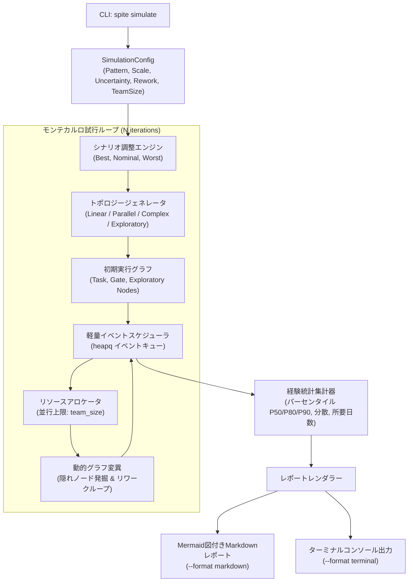

# アーキテクチャ決定記録 (ADR): シミュレーションモジュール アーキテクチャ

[English](adr.md)

- **ステータス**: 承認済み (Accepted)
- **決定者**: Spite アーキテクチャ＆エンジニアリングチーム
- **日付**: 2026-11-08
- **対象パス**: `/simulation`
- **関連ドキュメント**: [製品要求仕様書 (PRD)](prd.ja.md)

**用語の変更**: レポートでは`GateNode`をレビューと呼びます。これはレビューや承認を待つ期間を表し、開発チームの人員枠を占有しません。差し戻しによって手戻りが発生する場合があります。実装内部の`gate`という名前は維持します。この単純化された動作はLane ModelのGateのすべての意味を表すものではありません。

---

## 1. 背景と課題

Spite の従来のプロジェクト予測モデルは、プロジェクト全体の所要時間を単一の確率分布（対数正規分布など）に当てはめ、主観的な係数によって Best / Nominal / Worst の各シナリオを調整していました。[PRD](prd.ja.md) で定義した通り、実際のソフトウェアエンジニアリングにおける工期遅延は、以下のような構造的不確実性に起因しています。

- **Fog of War（戦場の霧）と未知の未知**: 調査・実装が進むにつれて動的に発掘される隠れたタスクや依存関係。
- **リワーク・差し戻しループ**: コードレビューの差し戻しやQA指摘、仕様不整合による循環的なやり直し。
- **Gate（承認・レビュー）待ち**: レビュー待ちキューや外部依存など、人員を追加しても短縮できないシリアルな待機時間。
- **リソース競合と並行性限界**: チーム人数の上限およびアムダールの法則・ブルックスの法則に起因する合流・直列ボトルネック。

これらの課題に対処するため、プロジェクトの動的トポロジーアンサンブルを生成し、リソース制約下での実行をシミュレーションする構造的モンテカルロエンジン（`spite simulate`）を導入します。本ADRでは、実行エンジン、グラフ生成、リソーススケジューリング、レポート生成に関する中核的なアーキテクチャ方針を決定します。

---

## 2. 決定要因 (Decision Drivers)

1. **実行パフォーマンス**: 一般的な開発端末で、GPUや重量級ランタイムを使わずに数千回（シナリオあたり2,000回以上）のモンテカルロ試行を数秒以内で完了できること。
2. **最小限の依存関係と可搬性**: プラットフォーム依存のC拡張や重量級ライブラリを持ち込まず、Spite の軽量なCLIフットプリントを維持すること。
3. **動的トポロジーへの対応**: 動的タスク発見や循環的リワークループなど、実行時のグラフ構造の変化を、スケジューリングの破綻なく柔軟に扱えること。
4. **Git親和性の高い共有可能な出力**: プルリクエスト（PR）やIssue、Wikiで直接閲覧・比較できる、摩擦ゼロのレポート形式（Markdown + Mermaid）を提供すること。

---

## 3. アーキテクチャ決定事項

### 決定 1: 重量級フレームワークを採用せず、軽量な独自離散事象シミュレータ (DES) を実装する

- **決定**: 汎用シミュレーションフレームワーク（`SimPy` 等）や巨大グラフライブラリ（`NetworkX` 等）を採用せず、標準Pythonのプリミティブ（`heapq` イベントキューとデータクラス）を用いた専用の軽量離散事象シミュレータを実装する。
- **根拠**:
  - `SimPy` などの汎用フレームワークは、エンティティごとにPythonジェネレータを使用するためコルーチンのコンテキストスイッチ負荷が高く、数千回のモンテカルロ試行におけるスループットを低下させる。
  - `(timestamp, event_type, payload)` を追跡する最小限のインメモリエベントキューにより、50ノード規模のグラフに対する2,000回試行を1秒未満で高速実行可能。
  - 外部依存を極力排除し、`uv` によるインストールと実行を高速かつシンプルに保つ。

### 決定 2: トポロジージェネレータの分離と特化ノードセマンティクスの採用

- **決定**: 静的なトポロジー骨格の生成と実行時の動的グラフ展開を明確に分離し、以下の専用セマンティクスを持つノード型を定義する。
  - `TaskNode`: 通常のエンジニアリング作業。所要時間は確率分布（三角分布/対数正規分布）からサンプリングされる。
  - `GateNode`: レビューやQA等の合流・承認ポイント。一定の待機時間が発生し、確率的に差し戻し（リワーク）をトリガーする。
  - `ExploratoryNode`: 調査や未知領域のタスク。完了時に確率的に新たな子ノードや依存関係を動的に注入する（Fog of War）。
  - `ReworkEdge`: Gate差し戻し時に上流ノードを再活性化させる有向フィードバックエッジ。
- **根拠**:
  - トポロジー生成器（`linear`, `parallel`, `complex`, `exploratory`）は初期骨格の構築に集中し、シミュレーションループ内でシナリオパラメータ（不確実性、リワーク率）に基づいて有機的にグラフを成長・変化させることができる。
  - グラフ生成と実行ロジックの分離により、再現性のためのランダムシード制御が容易になる。

### 決定 3: 並行性制限下における優先度付きリソーススケジューリング

- **決定**: 同時実行可能なアクティブタスク数を `--team-size` 以下に制限する優先度付きキューを導入する。前提条件が満たされたReadyタスクは、下流の推定クリティカルパスの深さ（Topological Rank / 最長残余パス長）に基づいて優先的にチームメンバーへ割り当てられる。
- **根拠**:
  - 実際の開発現場では、手空きになったエンジニアは適当なタスクではなく、クリティカルパス上のボトルネックタスクを優先して着手する。
  - チームサイズがグラフの並列度を下回った場合、自然にリソース競合待ちが発生し、人為的な係数調整なしに直列ボトルネックとアムダールの法則による停滞を再現できる。

### 決定 4: GitネイティブなMarkdownおよびMermaidレポートパイプライン

- **決定**: シミュレーション結果を、以下の要素を含む GitHub Flavored Markdown (GFM) レポートとして直接レンダリングするパイプラインを構築する。
  - パーセンタイル要約テーブル (P50, P80, P90, 平均, 標準偏差)。
  - 設定パラメータおよびシナリオ前提の明記。
  - 代表的なトポロジーサンプル、クリティカルパス、およびGateボトルネックを強調表示した Mermaid `flowchart TD` / `flowchart LR` ダイアグラムの埋め込み。
- **根拠**:
  - 専用のダッシュボードサーバや外部画像ホスティングを必要とせず、Gitリポジトリへのコミット、PR本文への貼り付け、各種Markdownビューアでの即時共有が可能になる。

---

## 4. システムアーキテクチャ構成図

---

## 5. 結果とトレードオフ

### メリット (Positive Consequences)
- **高いスループット**: 純粋なPythonによる軽量DESにより、複数シナリオのモンテカルロシミュレーションを数秒で実行可能。CLIでの対話的な試行錯誤を阻害しない。
- **高い説明性**: Mermaid図によって動的グラフを可視化することで、どのクリティカルパスやGate待ちが遅延要因となっているかをエンジニアやマネージャーが直感的に把握できる。
- **外部依存の極小化**: 余分なランタイムを要求せず、環境構築の摩擦がない。

### デメリットと緩和策 (Negative Consequences & Mitigations)
- **大規模グラフにおけるMermaid描画負荷**: 数百ノード規模のプロジェクトではMermaidダイアグラムが巨大になり、ブラウザの描画が重くなる可能性がある。
  - *緩和策*: ノード数が多い場合は非クリティカルな背景ノードを省略またはクラスタ化し、クリティカルパスと主要Gateに絞って出力するオプションを設ける。
- **個別開発者スキルの均一モデル化**: 開発メンバーを均一なキャパシティスロット（`team_size`）として扱っている点。
  - *緩和策*: マクロなプロジェクト予測としては十分な精度を持つ。個人のスキルや専門領域のモデリングは、将来の拡張余地として扱う。

---

## 6. 検討された代替案

1. **SimPy / SimJulia 等の汎用離散事象フレームワーク**:
   - *却下*: 高機能である一方、全エンティティにPythonジェネレータを使用するためオーバーヘッドが大きく、数千回のモンテカルロ試行に適さない。`heapq` を用いた独自実装の方が遥かに高速かつ直感的にシリアライズ可能。
2. **静的DAGモンテカルロ (従来のPERT/CPM)**:
   - *却下*: 固定ノードかつ非循環グラフを前提とするため、ソフトウェア開発における遅延の最大要因であるリワークループや未知タスクの動的発見（Fog of War）を表現できない。
3. **外部可視化パッケージ（Matplotlib / Graphviz バイナリ依存）**:
   - *却下*: Graphvizバイナリのインストールや画像生成パイプラインは、CIやコンテナ環境でのポータビリティを低下させる。Mermaidを用いたテキストベースのMarkdown埋め込みが最も軽量で共有性に優れている。
