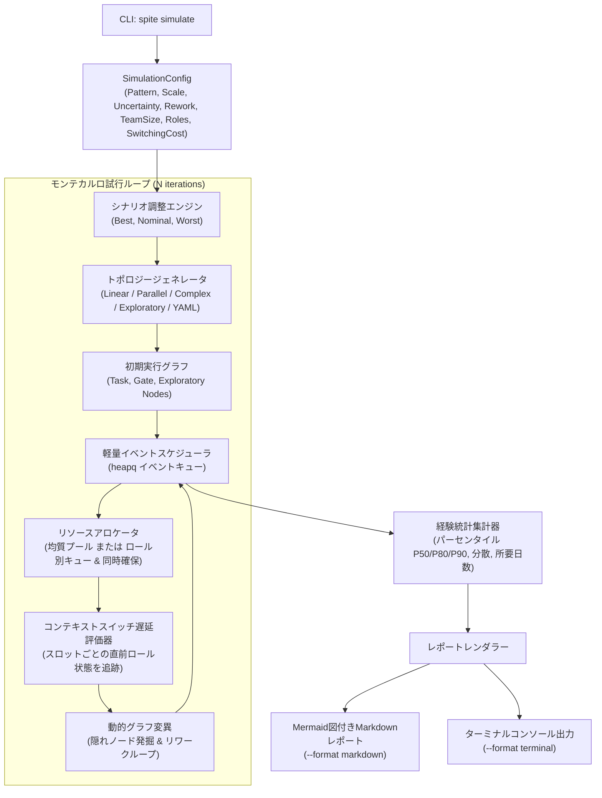

# アーキテクチャ決定記録 (ADR): シミュレーションモジュール アーキテクチャ

[English](adr.md)

- **ステータス**: 承認済み (Accepted)
- **決定者**: プロジェクトのメンテナー
- **日付**: 2026-11-08
- **対象パス**: `/simulation`
- **関連ドキュメント**: [製品要求仕様書 (PRD)](prd.ja.md)

**用語の変更**: レポートでは`GateNode`をレビューと呼びます。これはレビューや承認を待つ期間を表し、開発チームの人員枠を占有しません。差し戻しによって手戻りが発生する場合があります。実装内部の`gate`という名前は維持します。この単純化された動作はLane ModelのGateのすべての意味を表すものではありません。

---

## 1. 背景と課題

Spite の従来のプロジェクト予測モデルは、プロジェクト全体の所要時間を単一の確率分布（対数正規分布など）に当てはめ、主観的な係数によって Best / Nominal / Worst の各シナリオを調整していました。[PRD](prd.ja.md) で定義した通り、実際のソフトウェアエンジニアリングにおける工期遅延は、以下のような構造的不確実性に起因しています。

- **Fog of War（戦場の霧）と未知の未知**: 調査・実装が進むにつれて動的に発掘される隠れたタスクや依存関係。
- **リワーク・差し戻しループ**: コードレビューの差し戻しやQA指摘、仕様不整合による循環的なやり直し。
- **Gate（承認・レビュー）待ち**: レビュー待ちキューや外部依存など、人員を追加しても短縮できないシリアルな待機時間。
- **リソース競合と並行性限界**: チーム人数の上限およびアムダールの法則・ブルックスの法則に起因する合流・直列ボトルネック。
- **職能分業とコンテキストスイッチ**: 専門ロール（PM, Dev, QA など）間の調整遅延、およびロール切り替え時の認知的負荷。

これらの課題に対処するため、プロジェクトの動的トポロジーアンサンブルを生成し、リソース制約下での実行をシミュレーションする構造的モンテカルロエンジン（`spite simulate`）を導入します。本ADRでは、実行エンジン、グラフ生成、リソーススケジューリング、レポート生成に関する中核的なアーキテクチャ方針を決定します。

---

## 2. 決定要因 (Decision Drivers)

1. **実行パフォーマンス**: 一般的な開発端末で、GPUや重量級ランタイムを使わずに数千回（シナリオあたり2,000回以上）のモンテカルロ試行を数秒以内で完了できること。
2. **最小限の依存関係と可搬性**: プラットフォーム依存のC拡張や重量級ライブラリを持ち込まず、Spite の軽量なCLIフットプリントを維持すること。
3. **動的トポロジーへの対応**: 動的タスク発見や循環的リワークループなど、実行時のグラフ構造の変化を、スケジューリングの破綻なく柔軟に扱えること。
4. **Git親和性の高い共有可能な出力**: プルリクエスト（PR）やIssue、Wikiで直接閲覧・比較できる、摩擦ゼロのレポート形式（Markdown + Mermaid）を提供すること。
5. **組織の現実性とロールモデル化**: 職能分業、共同作業タスク、およびコンテキストスイッチによる現実的な遅延を、既存機能の後方互換性を保ちながらモデル化できること。

---

## 3. アーキテクチャ決定事項

### 決定 1: 重量級フレームワークを採用せず、軽量な独自離散事象シミュレータ (DES) を実装する

- **決定**: 汎用シミュレーションフレームワーク（`SimPy` 等）や巨大グラフライブラリ（`NetworkX` 等）を採用せず、標準Pythonのプリミティブ（`heapq` イベントキューとデータクラス）を用いた専用の軽量離散事象シミュレータを実装する。
- **根拠**:
  - `SimPy` などの汎用フレームワークは、エンティティごとにPythonジェネレータを使用するためコルーチンのコンテキストスイッチ負荷が高く、数千回のモンテカルロ試行におけるスループットを低下させる。
  - `(timestamp, event_type, payload)` を追跡する最小限のインメモリエベントキューにより、50ノード規模のグラフに対する2,000回試行を1秒未満で高速実行可能。
  - 外部依存を極力排除し、`uv` によるインストールと実行を高速かつシンプルに保つ。

### 決定 2: トポロジージェネレータの分離と特化ノードセマンティクスの採用

- **決定**: 静的なトポロジー骨格の生成と実行時の動的グラフ展開を明確に分離し、以下の専用セマンティクスを持つノード型を定義する。
  - `TaskNode`: 通常のエンジニアリング作業。所要時間は確率分布（三角分布/対数正規分布）からサンプリングされる。
  - `GateNode`: レビューやQA等の合流・承認ポイント。一定の待機時間が発生し、確率的に差し戻し（リワーク）をトリガーする。
  - `ExploratoryNode`: 調査や未知領域のタスク。完了時に確率的に新たな子ノードや依存関係を動的に注入する（Fog of War）。
  - `ReworkEdge`: Gate差し戻し時に上流ノードを再活性化させる有向フィードバックエッジ。
- **根拠**:
  - トポロジー生成器（`linear`, `parallel`, `complex`, `exploratory`）は初期骨格の構築に集中し、シミュレーションループ内でシナリオパラメータ（不確実性、リワーク率）に基づいて有機的にグラフを成長・変化させることができる。
  - グラフ生成と実行ロジックの分離により、再現性のためのランダムシード制御が容易になる。

### 決定 3: 並行性制限下における優先度付きリソーススケジューリング

- **決定**: 同時実行可能なアクティブタスク数を `--team-size` 以下に制限する優先度付きキューを導入する。前提条件が満たされたReadyタスクは、下流の推定クリティカルパスの深さ（Topological Rank / 最長残余パス長）に基づいて優先的にチームメンバーへ割り当てられる。
- **根拠**:
  - 実際の開発現場では、手空きになったエンジニアは適当なタスクではなく、クリティカルパス上のボトルネックタスクを優先して着手する。
  - チームサイズがグラフの並列度を下回った場合、自然にリソース競合待ちが発生し、人為的な係数調整なしに直列ボトルネックとアムダールの法則による停滞を再現できる。

### 決定 4: GitネイティブなMarkdownおよびMermaidレポートパイプライン

- **決定**: シミュレーション結果を、以下の要素を含む GitHub Flavored Markdown (GFM) レポートとして直接レンダリングするパイプラインを構築する。
  - パーセンタイル要約テーブル (P50, P80, P90, 平均, 標準偏差)。
  - 設定パラメータおよびシナリオ前提の明記。
  - 代表的なトポロジーサンプル、クリティカルパス、およびGateボトルネックを強調表示した Mermaid `flowchart TD` / `flowchart LR` ダイアグラムの埋め込み。
- **根拠**:
  - 専用のダッシュボードサーバや外部画像ホスティングを必要とせず、Gitリポジトリへのコミット、PR本文への貼り付け、各種Markdownビューアでの即時共有が可能になる。

### 決定 5: 人、役割、同時確保

人ごとに担当可能な役割を定義する。ロール別人数は専任者の簡略指定とし、指定がない場合は従来の均質プールを使う。共同タスクは役割ごとに別の人を同時に確保する。部分確保はせず、公平性は保証しない。役割が変わった人には切り替えコストを加算する。詳細は末尾の更新を参照。

---

## 4. システムアーキテクチャ構成図

---

## 5. 結果とトレードオフ

### メリット (Positive Consequences)
- **高いスループット**: 純粋なPythonによる軽量DESにより、複数シナリオのモンテカルロシミュレーションを数秒で実行可能。CLIでの対話的な試行錯誤を阻害しない。
- **高い説明性**: Mermaid図によって動的グラフを可視化することで、どのクリティカルパスやGate待ちが遅延要因となっているかをエンジニアやマネージャーが直感的に把握できる。
- **外部依存の極小化**: 余分なランタイムを要求せず、環境構築の摩擦がない。
- **現実的な組織モデル化**: 明示的なロール制約とコンテキストスイッチペナルティにより、職能間ハンドオフやマルチタスクの負荷を定量的に評価可能。

### デメリットと緩和策 (Negative Consequences & Mitigations)
- **大規模グラフにおけるMermaid描画負荷**: 数百ノード規模のプロジェクトではMermaidダイアグラムが巨大になり、ブラウザの描画が重くなる可能性がある。
  - *緩和策*: ノード数が多い場合は非クリティカルな背景ノードを省略またはクラスタ化し、クリティカルパスと主要Gateに絞って出力するオプションを設ける。
- **マルチロール割り当て時の同期遅延と飢餓**: 複数ロールの同時確保を要求するタスクは、ロールスロットの空きタイミングが一致しないと待機時間（同期遅延）が増加しやすい。
  - *緩和策*: アトミックな確保により部分ロックによるデッドロックを防ぎ、クリティカルパスの深いタスクを優先して空きスロットへ割り当てる。また段階的開示により、必要のない場合はデフォルトのシンプルな均質プール（`--team-size`）を利用可能とする。

---

## 6. 検討された代替案

1. **SimPy / SimJulia 等の汎用離散事象フレームワーク**:
   - *却下*: 高機能である一方、全エンティティにPythonジェネレータを使用するためオーバーヘッドが大きく、数千回のモンテカルロ試行に適さない。`heapq` を用いた独自実装の方が遥かに高速かつ直感的にシリアライズ可能。
2. **静的DAGモンテカルロ (従来のPERT/CPM)**:
   - *却下*: 固定ノードかつ非循環グラフを前提とするため、ソフトウェア開発における遅延の最大要因であるリワークループや未知タスクの動的発見（Fog of War）を表現できない。
3. **外部可視化パッケージ（Matplotlib / Graphviz バイナリ依存）**:
   - *却下*: Graphvizバイナリのインストールや画像生成パイプラインは、CIやコンテナ環境でのポータビリティを低下させる。Mermaidを用いたテキストベースのMarkdown埋め込みが最も軽量で共有性に優れている。
4. **共同タスクに対する貪欲な部分スロット確保（Greedy Partial Reservation）**:
   - *却下*: PMスロットを確保したままDevスロットの空きを待つ方式は、デッドロックの危険を生み、独立したPMタスクを飢餓させる。アトミックな同時確保は部分確保を防ぐが、公平性は保証しない。

## 決定: YAMLによる構造入力

[PRD](prd.ja.md)に記載したYAMLスキーマとCLIを採用する。IDの一意性、フィールドの型、参照先、循環の有無、完了状態の整合性を検証し、未完了ノードをトポロジー順に並べ、満たされた依存関係を除く。各試行はこのグラフから開始する。発見には既存のシナリオ別確率を用い、発見した作業は直後の依存先を待たせる。合計予測には入力された経過期間を加える。YAML入力と既存の継続予測は併用しない。YAML入力時に指定されたパターンと規模は警告して無視し、入力エラーではYAMLファイルを明示する。

テンプレートとGit下書きは標準出力にYAMLを出力する。Gitは`BASE..HEAD`の非マージコミットを選び、1コミットにつき1件の完了済みタスクを作る。依存関係と経過期間は推定しない。ユーザーが下書きを編集してから予測する。

## 人と役割による資源割り当て（更新）

役割は利用者が自由な粒度で定める担当可能な能力です。YAMLの`people`に一意な`id`と`roles`の一覧を指定すると、1人に複数の役割を持たせられます。`roles: {pm: 1, dev: 1}`は、それぞれ専任者1人ずつを作る簡略指定です。両方をYAMLに同時指定することはできません。CLIの`--roles`はYAMLの指定より優先します。どちらもない場合は従来の`--team-size`を使います。

タスクの各役割には別々の人を同時に割り当てます。兼任者も同じタスクでは1役のみ担当します。役割のないタスクには任意の1人を割り当て、直前の役割は変えません。gateは人員を占有しない待ち時間であり、役割を指定できません。割り当て不可能なタスクはエラーです。

人が前回と異なる役割を担当すると`--switching-cost`期間を追加します。初回は加算せず、共同タスクでは担当者の切り替えコストの最大値を加算します。発見作業と手戻りは元の作業の役割を引き継ぎます。同時確保は部分的なロックを防ぎますが、公平性は保証しません。人員感度分析では各人の能力を複製します。

## 決定: gateの手戻り先指定

gateは人員を占有しない待ちと判定とし、担当者が行うレビューは別のtaskで表す。YAMLのgateには上流のgate以外のタスクIDを`rework_target`として指定でき、完了済みタスクも対象にできる。差し戻し時はそのタスクを役割とともに再実行し、gateを再判定する。途中のタスクは再実行しない。省略時は従来の自動選択を使う。空でないgateの役割指定はエラーとする。

## 決定: 経験的分布による目標完了確率および遅延リスクの評価

共通[ADR-0006](../adr.ja.md)および[PRD](prd.ja.md)に準拠し、`--target-periods` および `--target-days` を導入する。各シナリオのシミュレーション完了期間サンプル配列から、期日内の完了確率を経験的割合 $\text{count}(\text{duration} \le \text{target}) / N$ として算出し、遅延リスクを $1 - P(\text{完了})$ として算出する。算出された指標は全レポート形式（Markdown、Terminal、HTML）およびスナップショットに反映する。

## 決定: タスクの工数・重み付けとgate手戻り確率

[PRD](prd.ja.md)に記載した`effort`および`rework_probability`の拡張を採用する。
1. **タスクの工数（effort）**: YAML構造のエンジニアリングタスクにおいて、任意の正の有限数値`effort`（既定1.0、gateには指定不可）を受け付ける。期間サンプリングは`effort`に比例してスケールし、大きなタスクほど期間のばらつき（分散）も拡大する。発見作業の工数と手戻りの割合は下記の追加決定に従う。
2. **gate手戻り確率（rework_probability）**: YAML構造のgateにおいて、任意の`rework_probability`（`[0.0, 1.0]`）を受け付け、そのgateにおける差し戻し判定時にシナリオ共通の手戻り率を上書きする。非gateタスクへの指定はエラーとする。

## 決定: プリセット構造におけるライフサイクルフェーズ別工数と推移トレンド

YAMLを手動作成せずとも、現実の開発ライフサイクルにおける非対称性（初期設計の難航、後半実装での負債や結合コスト、学習効果による加速）をモデル化できるようにする。
1. **フェーズ構造化**: プリセット構造生成処理において、ノードを標準的なフェーズ（上流の設計・アーキテクチャ、中盤の実装・開発、節目や終盤のレビュー・gate）に構造化する。
2. **フェーズ工数倍率**: CLIに `--design-effort` および `--dev-effort`（正の有限数値、既定1.0）を導入し、各フェーズのノードの基準工数をスケール可能にする。
3. **進行推移トレンド**: CLIに `--effort-trend`（`flat`, `fatigue`, `accelerating`、既定 `flat`）を導入する。
   - `flat`（均一）: フェーズ内で一定の工数を維持する。
   - `fatigue`（疲労・負債）: 後半の開発ノードほど工数が段階的に増加（最大1.5倍）し、技術的負債や結合摩擦による遅延を再現する。
   - `accelerating`（加速・学習効果）: 後半の開発ノードほど工数が段階的に逓減（最小0.7倍）し、習熟によるペース向上を再現する。
   - これらは `--topology` 指定時には警告を表示して無視する。

## 追加決定: 発見作業、手戻り、継続時の傾向

発見作業の effort は既定で 1.0 とし、探索タスクの `discovery_effort` で指定できる。手戻りは対象の effort にゲートの `rework_fraction`（0〜1、既定 1.0）を掛ける。継続時は累積完了数と残数から傾向の進行率を推定する。傾向は未校正の実験的な仮定であり、complexity risk と重複しうる。
