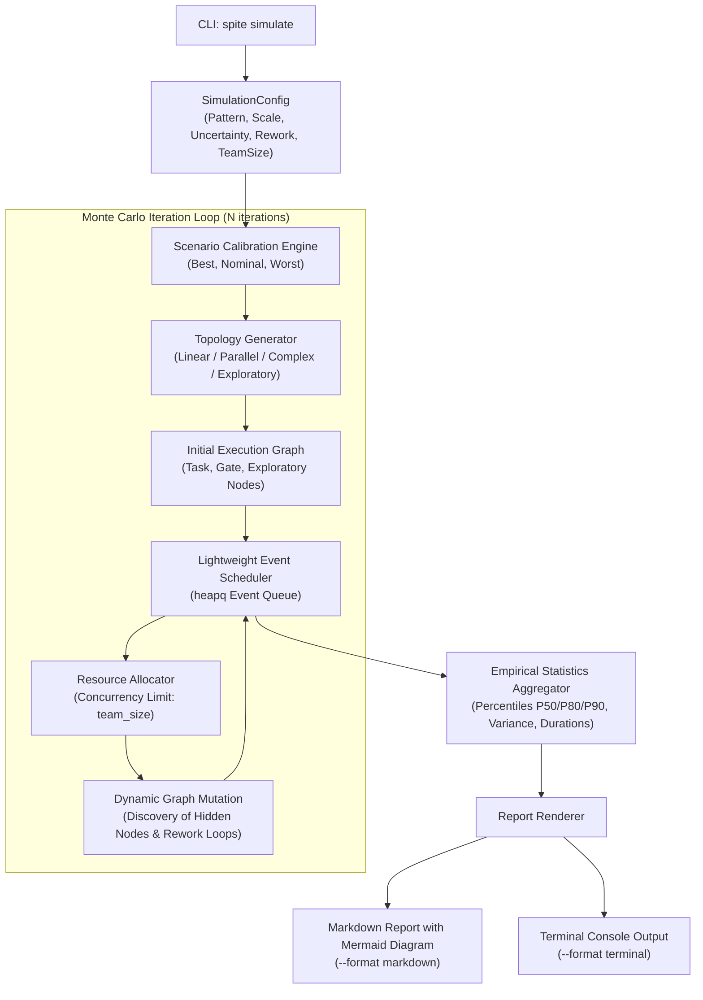

# Architecture Decision Record (ADR): Simulation Module Architecture

[日本語版 (Japanese)](adr.ja.md)

- **Status**: Accepted
- **Deciders**: Spite Architecture & Engineering Team
- **Date**: 2026-11-08
- **Target Path**: `/simulation`
- **Related Documents**: [Product Requirements Document (PRD)](prd.md)

---

## 1. Context & Problem Statement

Spite's baseline project forecasting relied on parametric distribution fitting (e.g., lognormal distributions) across entire projects, using subjective scalar adjustments to model Best, Nominal, and Worst scenarios. As identified in the [PRD](prd.md), real-world software engineering timelines are dominated by structural uncertainty:
- **Fog of War & Unknown Unknowns**: Dynamic discovery of hidden tasks and dependencies during exploration.
- **Rework Iterations**: Feedback loops triggered by code reviews, gate rejections, and defects.
- **Gate Latencies**: Review queues and external dependencies that cannot be compressed by adding personnel.
- **Resource Bottlenecks**: Concurrency limitations imposed by Amdahl's Law and Brooks's Law under team size constraints.

To address these challenges, we need to introduce a structural Monte Carlo simulation engine (`spite simulate`) that generates ensembles of dynamic project topologies and models resource-constrained execution. We must determine the core architectural patterns for execution, graph generation, resource scheduling, and report generation.

---

## 2. Decision Drivers

1. **Execution Performance**: Running thousands of Monte Carlo iterations (e.g., 2,000+ per scenario) within seconds on standard developer workstations without GPU or heavy external runtimes.
2. **Minimal Dependencies & Portability**: Preserving Spite's lightweight CLI footprint without introducing cumbersome or platform-dependent C-extensions.
3. **Dynamic Topology Support**: Seamlessly modeling runtime graph mutations (dynamic node discovery, cyclical rework loops) without violating acyclic topological assumptions during scheduling.
4. **Actionable & Shareable Output**: Delivering clean, zero-friction reports (Markdown + Mermaid) optimized for PR discussions, issue trackers, and Git version control.

---

## 3. Architecture Decisions

### Decision 1: Custom Lightweight Discrete-Event Simulation (DES) vs. Heavyweight Frameworks

- **Decision**: Implement a purpose-built, lightweight discrete-event simulation scheduler using standard Python primitives (`heapq` event queues, dataclasses) rather than adopting external general-purpose simulation frameworks (such as `SimPy`) or heavy network libraries (such as `NetworkX`).
- **Rationale**:
  - General frameworks like `SimPy` introduce process-generator overhead and coroutine context-switching costs that throttle pure Monte Carlo throughput across thousands of runs.
  - A specialized event queue tracking `(timestamp, event_type, payload)` with minimal dataclass allocations allows fast in-memory execution ($< 1$ second for 2,000 runs of a 50-node graph).
  - Eliminates unnecessary external runtime dependencies, keeping Spite lean and fast to install via `uv`.

### Decision 2: Decoupled Topology Generators with Specialized Node Semantics

- **Decision**: Decouple static structural pattern templates from dynamic runtime graph evolution, categorizing nodes into explicit semantic types:
  - `TaskNode`: Represents standard engineering units with sampled effort distributions (triangular/lognormal).
  - `GateNode`: Represents synchronization points (code reviews, QA approvals) with waiting latencies and probabilistic rejection/rework triggers.
  - `ExploratoryNode`: Represents uncharted work that probabilistically spawns new child nodes and dependencies upon completion (Fog of War).
  - `ReworkEdge`: Conditional feedback directed edges that re-activate upstream tasks upon gate rejection.
- **Rationale**:
  - Allows structural pattern generators (`linear`, `parallel`, `complex`, `exploratory`) to construct an initial skeleton, while the simulation loop organically expands and mutates the graph based on scenario calibration parameters (uncertainty and rework rates).
  - Decoupling topology generation from execution logic enables deterministic seeding for reproducible Monte Carlo runs.

### Decision 3: Priority-Based Resource Scheduling under Concurrency Limits

- **Decision**: Schedule tasks through a priority-based queue where concurrent active nodes cannot exceed `--team-size`. Ready nodes (whose prerequisite incoming edges are satisfied) are prioritized by their estimated downstream critical-path depth (Topological Rank / Longest Remaining Path).
- **Rationale**:
  - Realistic team behavior dictates that engineers prioritize tasks blocking critical milestones rather than picking arbitrary unblocked work.
  - When team size is less than the graph's width, concurrency contention naturally manifests, capturing serial bottlenecks and Amdahl's Law slowdowns without hardcoded heuristic adjustments.

### Decision 4: Git-Native Markdown & Embedded Mermaid Reporting Pipeline

- **Decision**: Construct a dedicated reporting pipeline that formats simulation outputs directly into structured GitHub Flavored Markdown (GFM) containing:
  - Percentile summary tables (P50, P80, P90, Mean, Standard Deviation).
  - Parameter and scenario attribution.
  - Embedded Mermaid `flowchart TD` / `flowchart LR` diagrams representing representative topology samples, highlighting critical paths and Gate bottlenecks with distinct CSS class styling.
- **Rationale**:
  - Markdown reports are directly committable to Git repositories, viewable in PR descriptions, and readable in any documentation viewer without requiring dedicated dashboard servers or external image-hosting infrastructure.

---

## 4. System Architecture & Component Diagram

---

## 5. Consequences & Trade-offs

### Positive Consequences
- **High Simulation Throughput**: Pure Python lightweight DES executes multi-scenario Monte Carlo runs in seconds, making iterative CLI exploration frictionless.
- **High Explainability**: Visualizing the dynamic graph via Mermaid enables engineers and managers to inspect the exact critical paths and gate wait bottlenecks causing project delays.
- **No Third-Party Runtime Bloat**: Avoids complex dependencies, ensuring high portability across environments.

### Negative Consequences & Mitigations
- **Large Graph Mermaid Rendering**: Large projects with hundreds of nodes can produce large Mermaid diagrams that may slow browser rendering.
  - *Mitigation*: Prune or cluster non-critical background nodes when generating Mermaid diagrams for large graphs, focusing the visual output on the critical path and gate bottlenecks.
- **Simplification of Individual Developer Skill Levels**: Treating team members as homogeneous resource slots (`team_size`).
  - *Mitigation*: This is intentional for macroscopic project forecasting; individual specialization modeling can be evaluated in future iterations if required.

---

## 6. Alternatives Considered

1. **SimPy / SimJulia Discrete Event Framework**:
   - *Rejected*: While powerful, SimPy relies on Python generators for every entity, introducing performance overhead that limits iteration counts. Custom event queues implemented with `heapq` proved substantially faster and easier to serialize.
2. **Static DAG Monte Carlo (Standard PERT/CPM)**:
   - *Rejected*: Traditional PERT/CPM assumes fixed nodes and no cycles, failing to capture rework loops and unexpected scope discovery (the primary causes of project delays in software engineering).
3. **Heavy Visualization Packages (Matplotlib / Graphviz binary dependencies)**:
   - *Rejected*: Requiring system-level Graphviz binaries or heavy graphical plotting stacks creates friction in headless CI and developer containers. Pure Mermaid Markdown embedding provides zero-dependency rendering directly supported by GitHub, GitLab, and IDEs.
