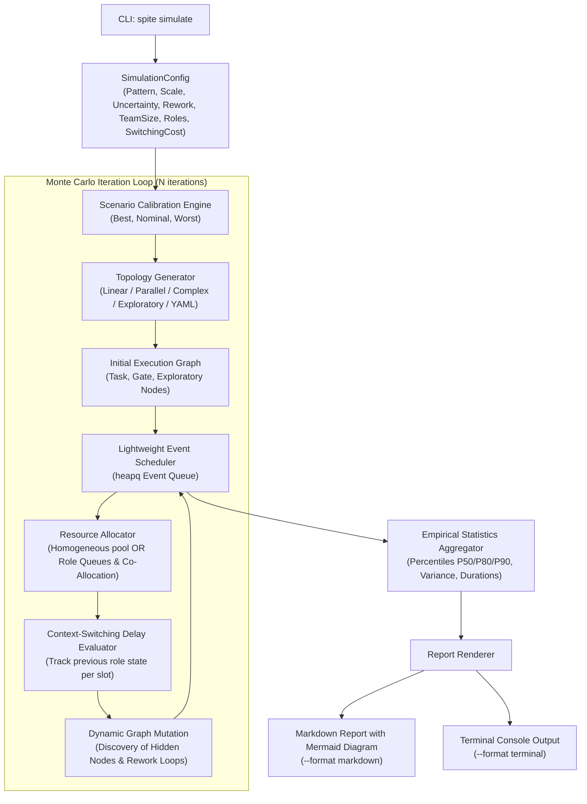

# Architecture Decision Record (ADR): Simulation Module Architecture

[日本語版 (Japanese)](adr.ja.md)

- **Status**: Accepted
- **Deciders**: Project maintainer
- **Date**: 2026-11-08
- **Target Path**: `/simulation`
- **Related Documents**: [Product Requirements Document (PRD)](prd.md)

**Terminology update**: Reports call `GateNode` a review. It represents time waiting for review or approval, without occupying a development team slot; rejection can trigger rework. The internal `gate` name remains in the implementation. This simplified behavior does not represent every meaning of Gate in the Lane Model.

---

## 1. Context & Problem Statement

Spite's baseline project forecasting relied on parametric distribution fitting (e.g., lognormal distributions) across entire projects, using subjective scalar adjustments to model Best, Nominal, and Worst scenarios. As identified in the [PRD](prd.md), real-world software engineering timelines are dominated by structural uncertainty:
- **Fog of War & Unknown Unknowns**: Dynamic discovery of hidden tasks and dependencies during exploration.
- **Rework Iterations**: Feedback loops triggered by code reviews, gate rejections, and defects.
- **Gate Latencies**: Review queues and external dependencies that cannot be compressed by adding personnel.
- **Resource Bottlenecks**: Concurrency limitations imposed by Amdahl's Law and Brooks's Law under team size constraints.
- **Specialized Roles & Context Switching**: Coordination delays between distinct roles (e.g., PM, Dev, QA) and cognitive penalties when switching roles.

To address these challenges, we need to introduce a structural Monte Carlo simulation engine (`spite simulate`) that generates ensembles of dynamic project topologies and models resource-constrained execution. We must determine the core architectural patterns for execution, graph generation, resource scheduling, and report generation.

---

## 2. Decision Drivers

1. **Execution Performance**: Running thousands of Monte Carlo iterations (e.g., 2,000+ per scenario) within seconds on standard developer workstations without GPU or heavy external runtimes.
2. **Minimal Dependencies & Portability**: Preserving Spite's lightweight CLI footprint without introducing cumbersome or platform-dependent C-extensions.
3. **Dynamic Topology Support**: Seamlessly modeling runtime graph mutations (dynamic node discovery, cyclical rework loops) without violating acyclic topological assumptions during scheduling.
4. **Actionable & Shareable Output**: Delivering clean, zero-friction reports (Markdown + Mermaid) optimized for PR discussions, issue trackers, and Git version control.
5. **Organizational Reality & Role Modeling**: Capturing real-world delivery bottlenecks created by role specializations, joint tasks, and context switching without breaking backwards compatibility.

---

## 3. Architecture Decisions

### Decision 1: Custom Lightweight Discrete-Event Simulation (DES) vs. Heavyweight Frameworks

- **Decision**: Implement a purpose-built, lightweight discrete-event simulation scheduler using standard Python primitives (`heapq` event queues, dataclasses) rather than adopting external general-purpose simulation frameworks (such as `SimPy`) or heavy network libraries (such as `NetworkX`).
- **Rationale**:
  - General frameworks like `SimPy` introduce process-generator overhead and coroutine context-switching costs that throttle pure Monte Carlo throughput across thousands of runs.
  - A specialized event queue tracking `(timestamp, event_type, payload)` with minimal dataclass allocations allows fast in-memory execution ($< 1$ second for 2,000 runs of a 50-node graph).
  - Eliminates unnecessary external runtime dependencies, keeping Spite lean and fast to install via `uv`.

### Decision 2: Decoupled Topology Generators with Specialized Node Semantics

- **Decision**: Decouple static structural pattern templates from dynamic runtime graph evolution, categorizing nodes into explicit semantic types:
  - `TaskNode`: Represents standard engineering units with sampled effort distributions (triangular/lognormal).
  - `GateNode`: Represents synchronization points (code reviews, QA approvals) with waiting latencies and probabilistic rejection/rework triggers.
  - `ExploratoryNode`: Represents uncharted work that probabilistically spawns new child nodes and dependencies upon completion (Fog of War).
  - `ReworkEdge`: Conditional feedback directed edges that re-activate upstream tasks upon gate rejection.
- **Rationale**:
  - Allows structural pattern generators (`linear`, `parallel`, `complex`, `exploratory`) to construct an initial skeleton, while the simulation loop organically expands and mutates the graph based on scenario calibration parameters (uncertainty and rework rates).
  - Decoupling topology generation from execution logic enables deterministic seeding for reproducible Monte Carlo runs.

### Decision 3: Priority-Based Resource Scheduling under Concurrency Limits

- **Decision**: Schedule tasks through a priority-based queue where concurrent active nodes cannot exceed `--team-size`. Ready nodes (whose prerequisite incoming edges are satisfied) are prioritized by their estimated downstream critical-path depth (Topological Rank / Longest Remaining Path).
- **Rationale**:
  - Realistic team behavior dictates that engineers prioritize tasks blocking critical milestones rather than picking arbitrary unblocked work.
  - When team size is less than the graph's width, concurrency contention naturally manifests, capturing serial bottlenecks and Amdahl's Law slowdowns without hardcoded heuristic adjustments.

### Decision 4: Git-Native Markdown & Embedded Mermaid Reporting Pipeline

- **Decision**: Construct a dedicated reporting pipeline that formats simulation outputs directly into structured GitHub Flavored Markdown (GFM) containing:
  - Percentile summary tables (P50, P80, P90, Mean, Standard Deviation).
  - Parameter and scenario attribution.
  - Embedded Mermaid `flowchart TD` / `flowchart LR` diagrams representing representative topology samples, highlighting critical paths and Gate bottlenecks with distinct CSS class styling.
- **Rationale**:
  - Markdown reports are directly committable to Git repositories, viewable in PR discussions, and readable in any documentation viewer without requiring dedicated dashboard servers or external image-hosting infrastructure.

### Decision 5: People, Capabilities, and Atomic Allocation

- **Decision**: Model each person as a resource with one or more user-defined roles (capabilities). Role names may be broad or fine-grained. A role-count mapping is shorthand for distinct dedicated people. With neither people nor role counts, retain the homogeneous `--team-size` pool.
- A task's role list requires one distinct available person per role. Match all roles atomically; a multi-role person can fill only one role in a joint task. Unspecified tasks use any one person. Gates are resource-free waits and cannot specify roles.
- Track each person's last assigned role. Changing roles adds `--switching-cost` periods while occupying all assigned people; the joint task delay is the maximum individual switching cost. The first role assignment and unassigned-role tasks incur no switching cost; unassigned-role tasks leave the previous role unchanged.
- Discoveries and rework inherit the roles of their originating work. Reject tasks with no feasible assignment. Atomic allocation avoids partial locks, but does not guarantee freedom from starvation.
- **Rationale**: Individual capabilities model shared capacity and switching, while dedicated counts provide a concise approximation without identifying people.

---

## 4. System Architecture & Component Diagram

---

## 5. Consequences & Trade-offs

### Positive Consequences
- **High Simulation Throughput**: Pure Python lightweight DES executes multi-scenario Monte Carlo runs in seconds, making iterative CLI exploration frictionless.
- **High Explainability**: Visualizing the dynamic graph via Mermaid enables engineers and managers to inspect the exact critical paths and gate wait bottlenecks causing project delays.
- **No Third-Party Runtime Bloat**: Avoids complex dependencies, ensuring high portability across environments.
- **Realistic Organizational Modeling**: Explicit role constraints and context-switching penalties allow engineering leaders to quantify the impact of cross-functional handoffs and solo developer multitasking.

### Negative Consequences & Mitigations
- **Large Graph Mermaid Rendering**: Large projects with hundreds of nodes can produce large Mermaid diagrams that may slow browser rendering.
  - *Mitigation*: Prune or cluster non-critical background nodes when generating Mermaid diagrams for large graphs, focusing the visual output on the critical path and gate bottlenecks.
- **Synchronization Latency & Starvation with Multi-Role Allocation**: Tasks requiring concurrent co-allocation across multiple roles may suffer from synchronization delays if slot availability does not align.
  - *Mitigation*: Atomic reservation prevents partial locks/deadlocks, and critical-path depth prioritization gives ready tasks preference without guaranteeing fairness. Progressive disclosure keeps the default mode simple and homogeneous (`--team-size`).

---

## 6. Alternatives Considered

1. **SimPy / SimJulia Discrete Event Framework**:
   - *Rejected*: While powerful, SimPy relies on Python generators for every entity, introducing performance overhead that limits iteration counts. Custom event queues implemented with `heapq` proved substantially faster and easier to serialize.
2. **Static DAG Monte Carlo (Standard PERT/CPM)**:
   - *Rejected*: Traditional PERT/CPM assumes fixed nodes and no cycles, failing to capture rework loops and unexpected scope discovery (the primary causes of project delays in software engineering).
3. **Heavy Visualization Packages (Matplotlib / Graphviz binary dependencies)**:
   - *Rejected*: Requiring system-level Graphviz binaries or heavy graphical plotting stacks creates friction in headless CI and developer containers. Pure Mermaid Markdown embedding provides zero-dependency rendering directly supported by GitHub, GitLab, and IDEs.
4. **Greedy Partial Slot Reservation for Joint Tasks**:
   - *Rejected*: Holding a PM slot while waiting for a Dev slot to free up risks deadlock and starves independent PM tasks. Atomic co-allocation avoids partial locks but does not guarantee fairness.

## Decision: YAML topology input

Accept the YAML schema and CLI described in the [PRD](prd.md). Validate IDs, types, references, acyclicity and completed-task consistency; topologically order pending nodes and remove satisfied dependencies. Each iteration starts from this graph. Existing scenario discovery probabilities apply; discovered work blocks immediate successors. Add elapsed periods to total forecasts. YAML and synthetic continuation cannot be combined. Ignore explicit pattern and scale settings with a warning when YAML is supplied; identify the YAML file in input errors.

Template and Git draft generation write YAML to standard output. Git selects non-merge commits in `BASE..HEAD`, one completed task per commit, without inferred dependencies or elapsed time. Users edit the draft before forecasting.
## Decision: Explicit gate rework target

Keep gates as resource-free waiting and rejection events; model staffed review as a separate task. A YAML gate can specify `rework_target` as an upstream non-gate task ID, including a completed task. Rejection repeats that task with its roles and retries the gate; intervening tasks are not repeated. Omission preserves the existing automatic target selection. Reject non-empty gate roles to avoid silently ignoring resource requirements.
